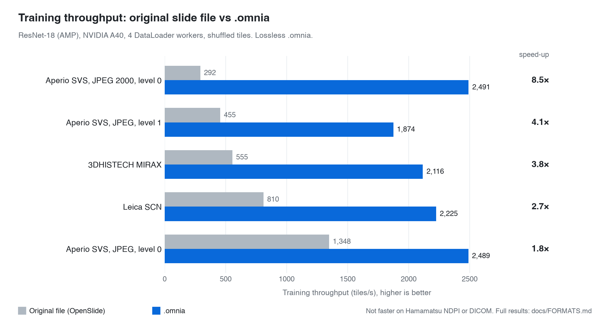
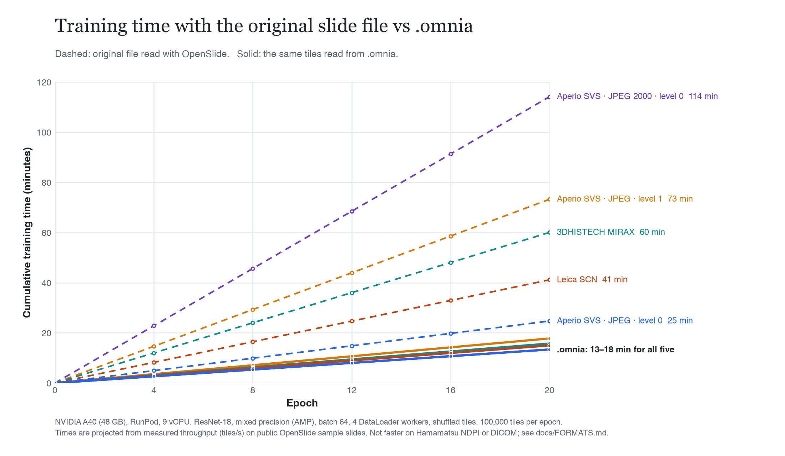
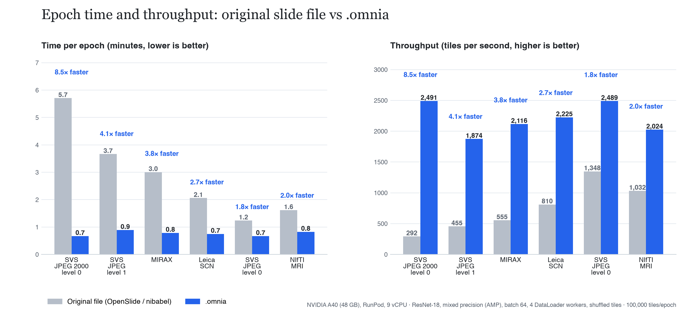
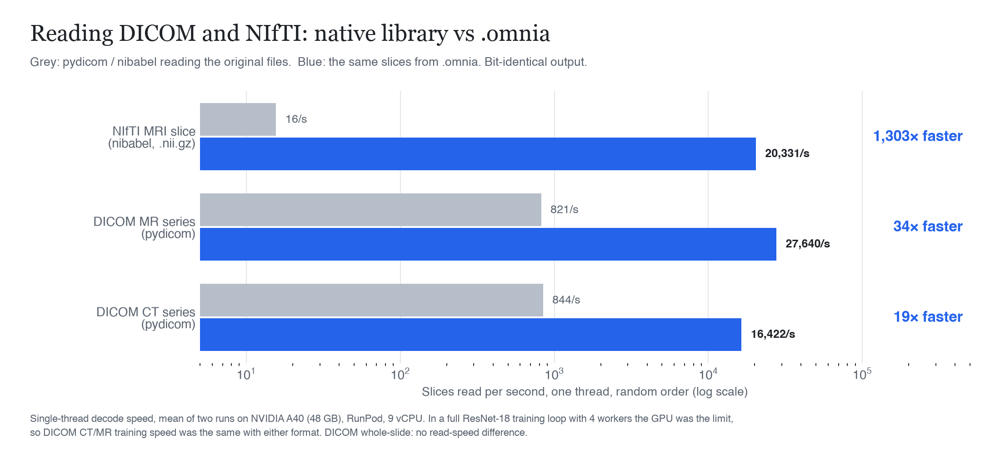

<h1 align="center">omnia-sdk</h1>

<p align="center">
  <b>Train on medical images faster.</b><br/>
  Convert whole-slide images, DICOM and NIfTI to one <code>.omnia</code> file and feed PyTorch from it.
</p>

<p align="center">
  <a href="LICENSE"></a>
  
  
  <a href="docs/FORMATS.md"></a>
</p>

<p align="center">
  <a href="#quick-start">Quick start</a> ·
  <a href="#benchmarks">Benchmarks</a> ·
  <a href="#supported-formats">Formats</a> ·
  <a href="#command-line">CLI</a> ·
  <a href="#python-api">Python API</a> ·
  <a href="#how-it-works">How it works</a> ·
  <a href="#contributing">Contributing</a>
</p>

<picture>
  <source media="(prefers-color-scheme: dark)" srcset="benchmarks/charts/hero_speedup_dark.png">
  
</picture>

---

Medical images are stored for viewing, not for training. A whole-slide image is a JPEG or JPEG 2000 pyramid
that has to be decoded tile by tile; a CT scan is hundreds of DICOM files; an MRI is a gzip stream you cannot
seek. Your data loader spends its time decoding, and the GPU waits.

`.omnia` stores the same pixels in a layout built for training: one file, fixed tile addresses, a fast
codec, a checksum on every block. Convert once, train many times.

- **Faster where decoding is the bottleneck.** 1.8× to 8.5× more training throughput on Aperio SVS, MIRAX, Leica SCN and NIfTI. 19–34× faster DICOM reads.
- **Exact.** Slide tiles match OpenSlide output; NIfTI, CT and MR slices round-trip bit for bit.
- **One format for slides and radiology.** SVS, NDPI, MRXS, SCN, TIFF, DICOM series, DICOM whole-slide, NIfTI.
- **No patient identifiers.** DICOM conversion keeps acquisition fields (modality, spacing, rescale) only.
- **Measured, not claimed.** Every number below comes from a script in this repo you can run on your own data.

## Quick start

### 1. Install (one line, no admin rights)

**macOS / Linux**

```bash
curl -fsSL https://raw.githubusercontent.com/mishel-0/omnia-sdk/main/install.sh | sh
```

**Windows** (PowerShell)

```powershell
irm https://raw.githubusercontent.com/mishel-0/omnia-sdk/main/install.ps1 | iex
```

The installer needs Python 3.11 or newer ([python.org](https://www.python.org/downloads/)). It creates a private
environment in `~/.omnia`, installs every format reader (OpenSlide, pydicom, wsidicom, nibabel) and adds the `omnia`
command to your PATH. It does not install PyTorch unless you ask (`OMNIA_WITH_TORCH=1`), so the download stays small.
Run it again to update.

Prefer pip?

```bash
pip install "omnia-sdk[all] @ https://github.com/mishel-0/omnia-sdk/archive/refs/heads/main.zip"
#   add ,train      for the PyTorch dataset
#   add ,benchmark  for `omnia benchmark` and `omnia recommend`
```

### 2. Check your machine

```bash
omnia doctor          # which formats this machine can convert
omnia doctor --fix    # install any missing readers
```

### 3. Convert

```bash
omnia convert slide.svs          # whole-slide image   -> slide.omnia
omnia convert slides/ out/       # a folder of slides  -> out/*.omnia
omnia convert ct_series/         # folder of DICOM     -> ct_series.omnia
omnia convert brain.nii.gz       # NIfTI volume        -> brain.omnia
omnia verify  slide.omnia        # check every block's CRC
```

### 4. Train

```python
import omnia_sdk
from torch.utils.data import DataLoader

dataset = omnia_sdk.OmniaDataset("slide.omnia")          # or a folder of .omnia files
loader = DataLoader(dataset, batch_size=64, shuffle=True, num_workers=4)

for tiles, labels in loader:
    ...
```

## Benchmarks

Same training loop, same GPU; only the file format changes. NVIDIA A40 (48 GB), 9 vCPU, ResNet-18 with mixed
precision, batch 64, 4 DataLoader workers, shuffled tiles. Public sample data (OpenSlide test slides, an OpenNeuro MRI,
NCI Imaging Data Commons DICOM).

### Training time



| Format | Original file | `.omnia` | Time per epoch (100k tiles) | Speed-up |
|---|---:|---:|---:|---:|
| Aperio SVS, JPEG 2000, full resolution | 292 tiles/s | 2,491 tiles/s | 5.7 → 0.7 min | **8.5×** |
| Aperio SVS, JPEG, 20x | 455 | 1,874 | 3.7 → 0.9 min | **4.1×** |
| 3DHISTECH MIRAX | 555 | 2,116 | 3.0 → 0.8 min | **3.8×** |
| Leica SCN | 810 | 2,225 | 2.1 → 0.7 min | **2.7×** |
| NIfTI brain MRI (`.nii.gz`) | 1,032 slices/s | 2,024 slices/s | 1.6 → 0.8 min | **2.0×** |
| Aperio SVS, JPEG, full resolution | 1,348 | 2,489 | 1.2 → 0.7 min | **1.8×** |



### DICOM and NIfTI reads



| Format | Native library | `.omnia` | Speed-up |
|---|---:|---:|---:|
| DICOM MR series (pydicom) | 821 slices/s | 27,640 slices/s | **34×** |
| DICOM CT series (pydicom) | 844 | 16,422 | **19×** |
| NIfTI slice from `.nii.gz` (nibabel) | 16 | 20,331 | **1,300×** |

Single thread, random order. In a full training loop with 4 workers the GPU was the limit for DICOM CT and MR, so
training speed was the same with either format there; faster reads help most when CPU cores are scarce.

### Reading the numbers honestly

- **Where it does not help:** Hamamatsu NDPI and DICOM training were ties; DICOM whole-slide was slower on the one
  (57-tile) sample tested. With 8 workers most slide gaps narrowed.
- **Size:** lossless `.omnia` can be larger than an already-compressed slide (NDPI: 519 MB vs 198 MB). `--codec jpeg`
  is 4–12× smaller and trained at the same speed, but is lossy.
- **Variance:** two runs on different hosts differed by up to 2× on some rows; epoch times are throughput × tiles, not 20 timed epochs.
- **Everything:** [`docs/FORMATS.md`](docs/FORMATS.md), [`benchmarks/epoch_times.json`](benchmarks/epoch_times.json),
  [`benchmarks/results.json`](benchmarks/results.json).

Reproduce on your machine:

```bash
omnia benchmark formats slide.svs scan.nii.gz ct_series/
```

## Supported formats

| Input | Extensions | Reader | Round trip |
|---|---|---|---|
| Aperio | `.svs` | OpenSlide | identical tiles |
| Hamamatsu | `.ndpi`, `.vms`, `.vmu` | OpenSlide | identical tiles |
| 3DHISTECH MIRAX | `.mrxs` | OpenSlide | identical tiles |
| Leica | `.scn` | OpenSlide | identical tiles |
| Ventana | `.bif` | OpenSlide | not yet benchmarked |
| Philips, generic tiled TIFF | `.tiff`, `.tif` | OpenSlide | identical tiles |
| DICOM series (CT, MR, PET, ...) | folder or `.dcm` | pydicom | bit-exact |
| DICOM whole-slide (VL WSI) | folder | wsidicom | identical tiles |
| NIfTI | `.nii`, `.nii.gz` | nibabel | bit-exact |

The installer includes every reader. With pip, install only what you need: `[svs]`, `[dicom]`, `[dicom-wsi]`, `[nifti]`, or `[all]`.
The OpenSlide C library comes as a wheel (`openslide-bin`), so there is no Homebrew or DLL setup on macOS or Windows.

## Command line

| Command | What it does |
|---|---|
| `omnia doctor [--fix]` | Shows which format readers are installed; `--fix` installs the missing ones. |
| `omnia convert <file or folder> [out]` | Detects the format and converts; a folder of slides converts each one. `--codec jpeg --quality 90` for slides, `--min-level N` to drop the highest-resolution levels. |
| `omnia verify <file.omnia>` | Checks the CRC of every block. |
| `omnia info <file.omnia>` | Levels, tile size, codec, size, source. |
| `omnia recommend <slide>` | One-minute check on your slide: size, read speed and fidelity per codec, and a recommendation. No GPU needed. |
| `omnia benchmark formats <files...>` | Training-loop comparison against each format's native reader on your hardware. |
| `omnia benchmark codecs <slides...>` | zstd levels, block sizes and JPEG qualities on your slides. |

## Python API

```python
import omnia_sdk

omnia_sdk.convert("slide.svs")                       # returns conversion stats
omnia_sdk.convert("slides/", "out/")                 # every slide in a folder

with omnia_sdk.OmniaContainer("slide.omnia") as c:   # random access
    tile = c.get_slice(42)                           # numpy array, verified by CRC

ds = omnia_sdk.OmniaDataset("cohort/", cache_mode="mmap")      # "ram", "mmap" or "none"
ds = omnia_sdk.ManifestOmniaDataset("cohort/", "labels.csv")   # one item per slide, labels from a CSV
```

## How it works

```
.omnia
├── header         magic, version
├── metadata       zstd-compressed JSON: levels, tile grid, dtype, source, volume info
└── blocks         [crc32][compressed tile] × N   (O(1) seek by tile index)
```

- **Slides** keep their pyramid levels and tile grid, so tile *i* at level *l* is one seek and one decompress.
- **Volumes** store one block per 2D slice in the scan's own dtype (no rescaling), with spacing and rescale values in the metadata.
- **Codecs:** zstd (lossless, default) or JPEG (lossy). One tile per block by default: packing 16 tiles into a block saved no space and made shuffled reads 6–14× slower ([`docs/CODECS.md`](docs/CODECS.md)).

## Contributing

Bug reports, new format readers and benchmark results from other hardware are all welcome.

```bash
git clone https://github.com/mishel-0/omnia-sdk.git && cd omnia-sdk
pip install -e ".[all,train,benchmark,dev]"
pytest
```

Adding a format: write a reader in `omnia_sdk/converters.py`, add a round-trip test in `tests/test_convert.py`
that proves pixels come back unchanged, and run `omnia benchmark formats` on a public sample.

## License

MIT. See [LICENSE](LICENSE). Sample data used in the benchmarks keeps its own licence (listed in
[`benchmarks/results.json`](benchmarks/results.json)).
