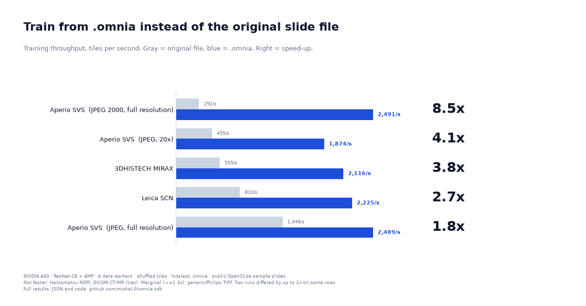

# omnia-sdk

**One fast, verifiable container for medical images used in ML training.**
Convert whole-slide images (SVS, NDPI, MRXS, SCN, TIFF), DICOM and NIfTI to `.omnia`, then feed PyTorch from it.

<p align="center"></p>

On a shuffled training loop, reading tiles from `.omnia` kept the GPU busier than reading the original slide with
OpenSlide: **8.5x** on a JPEG 2000 Aperio SVS at full resolution, **4.1x** on a 20x Aperio SVS, **3.8x** on MIRAX, **2.7x** on Leica SCN.
It is **not** faster everywhere (NDPI and DICOM CT/MR are ties) and the speed-up shrinks when you have plenty of CPU cores.
[Full results](docs/FORMATS.md) · [raw JSON](benchmarks/results.json) · [headline chart](benchmarks/charts/00_headline_normal_vs_omnia.png).

## Install

```bash
pip install "omnia-sdk[all]"        # slides, DICOM, NIfTI
pip install omnia-sdk               # core only (no format readers)
```

Python 3.11+. Extras: `[svs]` (OpenSlide slides), `[dicom]`, `[dicom-wsi]`, `[nifti]`.

## Use

```bash
omnia convert slide.svs                 # any supported file or folder -> slide.omnia
omnia convert slide.svs --codec jpeg    # smaller, lossy
omnia verify slide.omnia                # checks every CRC
omnia info slide.omnia
omnia recommend slide.svs               # ~1 minute, no GPU: which codec suits this slide
omnia benchmark formats a.svs scan.nii.gz --zstd-levels 1 9   # compare against the native reader on your machine
```

```python
import omnia_sdk
from torch.utils.data import DataLoader

omnia_sdk.convert("slide.svs")
ds = omnia_sdk.OmniaDataset("slide.omnia")
loader = DataLoader(ds, batch_size=64, shuffle=True, num_workers=4)
```

## What it supports

| Input | Reader | Status |
|---|---|---|
| Aperio SVS, Hamamatsu NDPI, 3DHISTECH MIRAX, Leica SCN, generic and Philips TIFF | OpenSlide | tested, tiles identical to `read_region` |
| NIfTI (`.nii`, `.nii.gz`) | nibabel | tested, bit-exact |
| DICOM series (CT, MR, ...) | pydicom | tested, bit-exact; patient identifiers are not copied |
| DICOM whole-slide | wsidicom | works, tiles identical; slower than wsidicom on the one sample tested |

A `.omnia` file is CRC-checked per block, lossless by default (zstd) or lossy (JPEG), with O(1) tile access.
The header allow-list for radiology keeps modality, spacing and rescale values only. Burned-in text in pixels is not detected.

## Where it helps, and where it doesn't

Measured on one NVIDIA A40 (9 vCPU), ResNet-18, 4 data workers, public sample slides, two runs that differed by up to 2x on some rows:

- Faster to train from: Aperio SVS, MIRAX, Leica SCN, NIfTI.
- About the same: Hamamatsu NDPI, DICOM CT and MR.
- Not shown to help: DICOM whole-slide (one 57-tile sample, slower).
- Lossless `.omnia` is often **larger** than an already-compressed slide (NDPI 519 MB vs 198 MB); JPEG mode is 4-12x smaller but lossy,
  and its effect on model accuracy was not measured.
- With 8 workers most slide gaps closed in the earlier run: the win is mostly needing fewer CPU cores.

Reproduce everything with `omnia benchmark formats`. Sample sources and licences are listed in [`benchmarks/results.json`](benchmarks/results.json).

## Development

```bash
pip install -e ".[all,dev]"
pytest
python benchmarks/build_report.py       # regenerate charts and JSON from the recorded runs
```

The earlier README (cuCIM comparison, Colab notebook) is kept in [`docs/LEGACY_README.md`](docs/LEGACY_README.md).

MIT licensed.
